<p align="center">
  
</p>

[](https://github.com/mikelj14/30-min-app/actions/workflows/ci.yml)
[](https://github.com/mikelj14/30-min-app/releases/latest)

Do you have a hard time getting out of bed without reaching for your phone?
Me too. Five minutes of news turns into forty, and the morning is gone before
it started. So I built 30-Min.

## What it does

The first time you unlock your phone in the morning, 30-Min covers the screen
with a countdown. No apps, no feeds, no messages until it runs out. Then your
phone is yours again, and the app counts the morning toward your streak.

- **You pick the window and the length.** For example: block 30 minutes, starting
  the first time I unlock between 07:00 and 10:00. Any length from 5 to 120 minutes.
- **Calls still work.** Press and hold the phone button to open the dialer.
- **There's a way out.** Tap the exit button 5 times and confirm. It ends today's
  block and breaks your streak, so it's there for real emergencies.
- **Streaks and history.** A calendar of protected mornings, missed ones, and
  the time you got back.
- **Private by design.** No account, no ads, no tracking. The app has no internet
  permission at all, so your data never leaves the phone.

## Install

Android 12 or newer. Not on the Play Store yet, so you install it from here:

1. On your phone, open the [latest release](https://github.com/mikelj14/30-min-app/releases/latest)
   and download the `.apk` file.
2. Open it. Android asks to allow installs from your browser: allow it once.
3. Open 30-Min and follow the setup checklist and the short tutorial.

If a permission switch is greyed out ("restricted setting"): open phone
Settings › Apps › 30-Min, tap ⋮ (top right), choose **Allow restricted settings**,
then try again. Android does this for apps installed from a file.

To update, install the newer `.apk` the same way. Your history stays.

Found a bug or have an idea? [Open an issue](https://github.com/mikelj14/30-min-app/issues/new/choose).
The app version is at the bottom of its Settings tab.

## How it's built

- **Kotlin** and **Jetpack Compose** with Material 3, one small native app
- **Room** (SQLite) for history, kept only on the device
- **AlarmManager** exact alarms to open the morning window, a **foreground service**
  that waits for your first unlock, and a **screen overlay** for the block
- **GitHub Actions** CI on every pull request: secret scan, ktlint, Android Lint,
  unit tests, debug and release builds
- **Signed releases** built and published automatically from version tags
- **Renovate** for dependency updates, Dependabot alerts for security
- Runs on a budget of $0 a month

It's also my DevOps learning project, so every step above was set up by hand
and is described below.

<details>
<summary><strong>For developers: build, lint, CI, release</strong></summary>

### Requirements

- JDK 17
- Android SDK with `platforms;android-37.0` and `build-tools;36.0.0`
- Android 12+ device (minSdk 31)

Or skip local setup and use the Dev Container (needs only Docker).

### Build

```bash
./gradlew assembleDebug     # APK in app/build/outputs/apk/debug/
./gradlew installDebug      # install on a connected device (adb)
```

### Lint

```bash
./gradlew ktlintCheck       # report style violations
./gradlew ktlintFormat      # auto-fix what it can
```

### Dev Container

`.devcontainer/` holds a pinned JDK + Android SDK image. Open the repo in any
Dev Container-aware editor, or build from the shell:

```bash
docker build -t thirtymin-dev .devcontainer
docker run --rm -v "$PWD":/work -w /work \
  -v thirtymin-gradle:/home/ubuntu/.gradle thirtymin-dev ./gradlew assembleDebug
```

Installing to a phone still runs on the host (the container has no adb).

### CI

`.github/workflows/ci.yml` runs on every push to `main` and every pull request:
secret scan (gitleaks), Gradle wrapper validation, ktlint, Android Lint, unit tests,
debug build and release build (R8 shrinking).

### Release

`.github/workflows/release.yml` runs when a version tag is pushed:

```bash
git switch main && git pull
git tag v0.2.0 && git push origin v0.2.0
```

It checks the tag is on `main`, runs the checks, builds a release APK signed
with the key from GitHub secrets (`RELEASE_KEYSTORE_BASE64`,
`RELEASE_KEYSTORE_PASSWORD`, `RELEASE_KEY_ALIAS`), and publishes a GitHub
Release (marked Latest) with the APK and its sha256. Tag `vX.Y.Z` gives versionCode
`X*10000 + Y*100 + Z`; tags must only go up.

</details>
